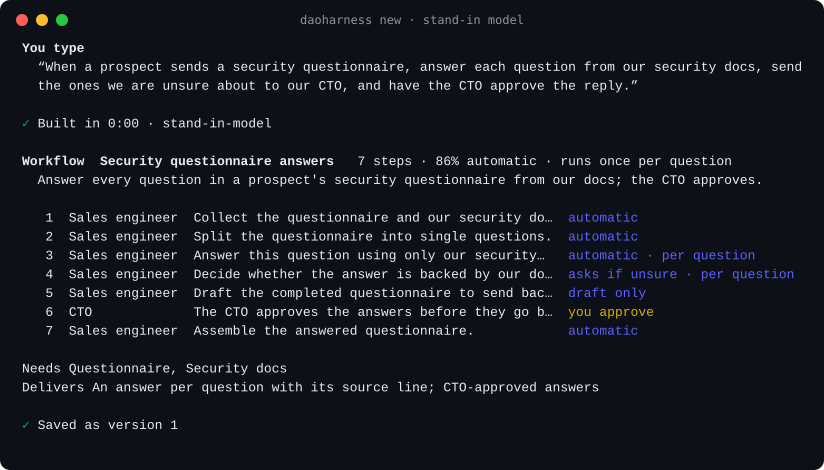
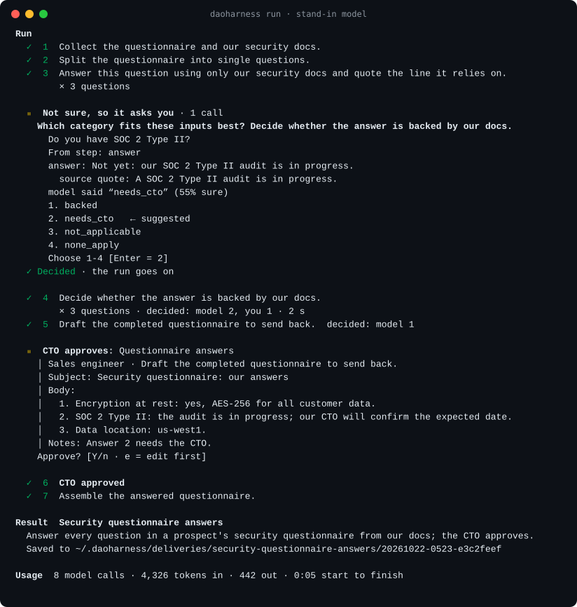

<p align="center">
  
</p>

<p align="center">
  <a href="LICENSE"></a>
  <a href="https://github.com/DaoBrewAI/DaoHarness/actions/workflows/tests.yml"></a>
  
</p>

# DaoHarness

**An open-source, plug-and-play harness for AI-native services: bring your own model and run it from your
terminal.**

> Claude Code is a harness for a programmer. DaoHarness is a harness for a service firm.

Describe a job you repeat in one sentence. DaoHarness turns it into a workflow: the steps, the person who signs off,
and what it delivers. Then it runs the workflow on your input, one item at a time when the input holds many, stops
for a person wherever a decision is unsure or a message would leave the building, and saves the result to a folder.

## Try it in 60 seconds, no API key

```bash
pip install git+https://github.com/DaoBrewAI/DaoHarness
daoharness-demo            # a security questionnaire, from one sentence to an approved answer set
daoharness-demo --list     # three example workflows
```

The demo runs the real engine on a stand-in model, so you see validation, per-item steps, decisions, a person's
approval and the delivered package without calling any provider. No Python 3.11 at hand?
`uvx --from git+https://github.com/DaoBrewAI/DaoHarness daoharness-demo` fetches one for you.

## Run your own job on your own model

```bash
pip install "daoharness[server] @ git+https://github.com/DaoBrewAI/DaoHarness"

export DAOHARNESS_PROVIDER=openai        # or gemini, groq, openrouter, together, ollama
export DAOHARNESS_MODEL=<a model your provider serves>
export OPENAI_API_KEY=...                # your provider's usual key variable

daoharness serve     # the local server: 127.0.0.1 only, your model, files in ~/.daoharness
daoharness new       # in another terminal: describe a job you repeat, in one sentence
daoharness run       # paste the input, then approve, reject or edit each item
```

<p align="center">
  
</p>

`daoharness approvals`, `watch`, `ls`, `show` and `status` do what they say. Each finished run leaves `result.md` and
`package.json` in `~/.daoharness/deliveries/<workflow>/<run>/`. Both pictures are the real terminal and engine,
running on a stand-in model.

DaoHarness does not ship, host or pay for a model. One model does everything (building the workflow, running each
step and making decisions) through the included adapter, `daoharness.adapters.OpenAICompatibleModel`, which uses
only the standard library and sends each request straight to your provider with your key. It asks for strict
structured output and falls back to JSON mode where an endpoint does not support it.

| Setting | What it does |
|---|---|
| `DAOHARNESS_PROVIDER` | `openai`, `gemini`, `groq`, `openrouter`, `together` or `ollama` |
| `DAOHARNESS_BASE_URL` | Any other OpenAI-compatible endpoint (LM Studio, vLLM, a gateway), instead of a provider |
| `DAOHARNESS_MODEL` | The model to use |
| `DAOHARNESS_API_KEY` | Your key, if the provider's usual variable (`OPENAI_API_KEY`, `GEMINI_API_KEY`, ...) is not set |
| `DAOHARNESS_MAX_TOKENS` | Optional cap on each reply |

## What it does

- **One sentence in, a workflow out.** The model writes a workflow spec from your description. The engine validates
  it and gives the model one retry with the errors. You see the steps before you save.
- **Twelve step types.** Collect, extract fields, match a checklist, score, route, generate questions, draft a
  message, summarize, deliver, split into items, a generic model step, and a person's approval.
- **One step, many items.** Split one input into items (applicants, questions, invoices), run steps once per item,
  then approve the whole batch with a verdict per item: approve, reject or edit. Edits flow to the steps after.
- **Unsure goes to a person.** Checklists, scores and routes are decisions: the model answers with a confidence, and
  anything below the threshold (0.75 unless you set another) waits for you.
- **Drafts only.** A message to anyone outside is a draft, and a person approves it. Identifiers are masked for the
  approver, and nothing is ever sent.
- **Runs that survive.** Every call is cached before it is merged, so a stopped run continues where it left off
  without repeating work. Every action is applied once, even when a command runs twice.
- **Token usage, not guesses.** Each run reports its model calls and the tokens your provider measured.

## What it does not do

This is v0, and some things are missing on purpose:

- **No web research.** A step that needs the web, or any source the engine cannot reach, stops the run there as a
  gap you can see before you run it.
- **No connectors.** Nothing reads your email, drive or chat, and nothing is sent anywhere.
- **Quotes are shown, not verified.** Steps quote the input they rely on; a positive claim without a quote is flagged
  for the approver, but the quote is not checked against the text.
- **One person, one machine, one model.** There are no roles, no routing between models and no web UI: the terminal
  is the interface.
- **Generic prompts.** The instructions that build workflows are short and general, so drafts are rougher than they
  could be. Read the steps, and edit or rebuild before you save.

DaoHarness hosted is invite-only. The same terminal works with it after `daoharness login --url ...`.

## Plug in your own pieces

The engine talks to the outside world through small ports, and depends only on the Python standard library and
`jsonschema`.

| Port | What you provide | Included |
|---|---|---|
| `ModelPort` | Any model: one `generate(...)` call that returns JSON matching a schema | Any OpenAI-compatible endpoint; a stand-in model |
| `DecisionPort` | Optional: your own decider for checklists, scores and routes, instead of the model | None |
| `WorkflowStore` | Where workflows, runs and approvals live | Files with locks |
| `MembershipPort`, `Notifier` | Who may approve, and how they hear about it | One person; no notifications |

```python
from datetime import datetime, timezone

from daoharness.adapters import OpenAICompatibleModel
from daoharness.file_store import FileWorkflowStore
from daoharness.service import WorkflowService

service = WorkflowService(
    store=FileWorkflowStore("./workflows"),
    model=OpenAICompatibleModel.from_env(),
    membership=MyMembership(),    # resolve(org_id, approver_role) -> who approves
    notifier=MyNotifier(),        # approval_requested(org_id, approval)
    clock=lambda: datetime.now(timezone.utc).isoformat(),
    submit=lambda job: job(),     # runs advance inline; pass a thread or a queue instead
)
draft = service.create("my-org", "build-1", "Every Monday, check new vendor contracts against our policy...")
```

`daoharness/testing.py` has stand-in versions of every port.

## Safety

- The local server listens on 127.0.0.1 only, refuses requests another site's page starts, and keeps everything in
  files under `~/.daoharness` that only you can read.
- Models read untrusted input and can be led astray by it (prompt injection). That is why nothing here sends
  anything: messages are drafts, and a person approves them.
- DaoHarness does not decide that you comply with any rule. The person who approves is responsible for what goes
  out.

## Three examples

| Example | The one sentence, shortened |
|---|---|
| `security-questionnaire` | Answer each question of a prospect's security questionnaire from our docs; the CTO approves |
| `accounting-intake` | Check a new client's documents against the intake checklist; a partner approves the email |
| `recruiting-screening` | Score a resume against the role; the hiring manager approves the email |

The last two are different businesses with the same skeleton: gather, extract, check, decide, ask, draft,
**a person approves**, summarize, deliver.

## Development

```bash
pip install -e ".[test]"
pytest -q
```

See [CONTRIBUTING.md](CONTRIBUTING.md). Adapters for other model APIs and example workflows from real use (no
client data) are the most useful contributions right now.

## License

[Apache-2.0](LICENSE). Copyright DaoBrew AI; see [NOTICE](NOTICE).

**Agents propose. A person approves.**
