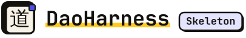

<p align="center">
  <picture>
    <source media="(prefers-color-scheme: dark)" srcset="docs/wordmark-dark.svg">
    
  </picture>
</p>

<h3 align="center">One sentence in. A workflow your people sign off.</h3>

<p align="center">
  <a href="https://github.com/DaoBrewAI/DaoHarness/actions/workflows/tests.yml"></a>
  <a href="LICENSE"></a>
  
  
</p>

<p align="center">
  <a href="#quickstart">Quickstart</a> ·
  <a href="#how-it-works">How it works</a> ·
  <a href="#same-skeleton-different-trades">Examples</a> ·
  <a href="#skeleton-and-hosted">Skeleton and hosted</a> ·
  <a href="#faq">FAQ</a>
</p>

<p align="center">
  
</p>
<p align="center"><sub>A recording of the real terminal and engine, on a stand-in model so it runs anywhere. Slowed down so you can read it.</sub></p>

**Claude Code is a harness for a programmer. DaoHarness is a harness for a service firm.**

Every AI service business rebuilds the same thing for every client:
- map the process;
- decide which steps a model can do and which a person must sign;
- run it, and keep the record.

DaoHarness Skeleton turns that into one sentence. Describe a job you repeat and it drafts the workflow: the steps, who acts, where a person signs off, and what gets delivered. It then runs the workflow on your input, one item at a time. It stops for a person when a decision is unsure or a message would leave the building, and it saves the result.

## Quickstart

The demo needs no API key:

```bash
pip install git+https://github.com/DaoBrewAI/DaoHarness
daoharness-demo              # one sentence → workflow → run → the CTO approves → result
daoharness-demo --list       # three example workflows
```

No Python 3.11? Run `uvx --from git+https://github.com/DaoBrewAI/DaoHarness daoharness-demo` and uvx fetches one for you.

**Your job, your model.** Any OpenAI-compatible endpoint works: OpenAI, Gemini, Groq, OpenRouter, Together, Ollama, LM Studio and vLLM.

```bash
pip install "daoharness[server] @ git+https://github.com/DaoBrewAI/DaoHarness"
export DAOHARNESS_PROVIDER=openai DAOHARNESS_MODEL=<model> OPENAI_API_KEY=<key>
daoharness serve             # the local server: 127.0.0.1 only, files in ~/.daoharness
daoharness new --run "Every Monday, check new vendor contracts against our policy; legal approves."
```

Run `daoharness new` in a second terminal.

<details>
<summary><b>All settings and commands</b></summary>

| Setting | What it does |
|---|---|
| `DAOHARNESS_PROVIDER` | `openai`, `gemini`, `groq`, `openrouter`, `together` or `ollama` |
| `DAOHARNESS_BASE_URL` | Any other OpenAI-compatible endpoint (LM Studio, vLLM, a gateway), instead of a provider |
| `DAOHARNESS_MODEL` | The model to use |
| `DAOHARNESS_API_KEY` | Your key, if the provider's usual variable (`OPENAI_API_KEY`, `GEMINI_API_KEY`, ...) is not set |
| `DAOHARNESS_MAX_TOKENS` | Optional cap on each reply |

| Command | What it does |
|---|---|
| `daoharness new` | Build a workflow from one sentence; add `--run` to run it straight away |
| `daoharness run` | Run a saved workflow |
| `daoharness approvals` | List what is waiting for you |
| `watch`, `ls`, `show`, `status` | Do what they say |

Each finished run leaves `result.md` and `package.json` in `~/.daoharness/deliveries/<workflow>/<run>/`.
</details>

## How it works

```mermaid
flowchart LR
    S["<b>One sentence</b><br/>a job you repeat"] --> W["<b>Workflow</b><br/>steps · roles · sign-offs"]
    W --> V{"Valid?"}
    V -- "errors go back<br/>to the model once" --> W
    V -- "yes" --> R["<b>Run</b><br/>one item at a time"]
    R --> D{"Sure<br/>enough?"}
    D -- "no" --> P["A person decides"]
    D -- "yes" --> A
    P --> A["<b>A person approves</b><br/>approve · edit · reject"]
    A --> O["<b>Delivered</b><br/>result.md · package.json"]
    classDef plain fill:#F7F2E7,stroke:#14120F,stroke-width:2.5px,color:#14120F
    classDef work fill:#E4E4FF,stroke:#14120F,stroke-width:2.5px,color:#14120F
    classDef human fill:#FFF0C2,stroke:#14120F,stroke-width:2.5px,color:#14120F
    classDef done fill:#DDF3E4,stroke:#14120F,stroke-width:2.5px,color:#14120F
    class S,V,D plain
    class W,R work
    class P,A human
    class O done
```



- **One sentence in, a workflow out.** The model writes a workflow spec. The engine validates it and gives the model one retry with the errors. You see every step before you save.
- **Twelve step types:** collect, extract fields, match a checklist, score, route, split into items, generate questions, draft a message, summarize, a generic model step, a person's approval and deliver.
- **One step, many items.** Split one input into items (questions, applicants, invoices) and run steps once per item. Then approve the whole batch with a verdict per item: approve, edit or reject. Edits flow to the steps after.
- **Unsure goes to a person.** Checklists, scores and routes are decisions with a confidence. Below the threshold (0.75 unless you set another), they wait for you.
- **Drafts only.** A message to anyone outside is a draft that a person approves. Nothing is ever sent.
- **Runs that survive.** Every model call is cached before it is used. A stopped run picks up where it left off without repeating work.
- **Measured, not guessed.** Each run reports its model calls and the tokens your provider measured.

## Same skeleton, different trades

| Example | The one sentence, shortened | Who signs off |
|---|---|---|
| `security-questionnaire` | Answer each question from our security docs; send the unsure ones to the CTO | CTO |
| `accounting-intake` | Check a new client's documents against the intake checklist; ask for what is missing | Partner |
| `recruiting-screening` | Score each resume against the role; draft the reply | Hiring manager |

These are three different businesses with the same skeleton: gather, extract, check, decide, ask, draft, **a person approves**, deliver. Try one with `daoharness-demo accounting-intake`.

## Skeleton and hosted

|  | **Skeleton** · this repo, Apache-2.0 | **DaoHarness hosted** · invite-only |
|---|---|---|
| Model | Yours, with your key | Ours: you only sign in |
| Interface | Terminal | Terminal or web |
| People | One person, one machine | Teams, roles and an approval inbox |
| Sources | What you paste in | Also web research and connectors |
| Industry packs | Not included | Private, built with the experts who earned them |

The same terminal works with both. To use hosted, run `daoharness login --url <your DaoHarness address>`; it needs no model key.

## FAQ

<details>
<summary><b>How is this different from LangGraph, CrewAI or other agent frameworks?</b></summary>

Those give you building blocks to program agents. DaoHarness starts from the business: you describe a job you repeat and get a checked workflow, with no graph code to write. That workflow has:
- explicit sign-offs;
- per-item runs;
- decisions that ask a person when unsure;
- a delivered package.

Every piece is swappable: your model, your decider, your store.
</details>

<details>
<summary><b>Does it send anything anywhere?</b></summary>

Only your prompts, to your model provider. Messages are drafts for a person to approve, and nothing is sent. The local server listens on 127.0.0.1. It keeps everything in files under `~/.daoharness` that only you can read.
</details>

<details>
<summary><b>Which models work?</b></summary>

Any OpenAI-compatible chat endpoint. The adapter asks for strict structured output (Gemini and Vertex AI start in JSON mode). Where an endpoint does not support it, it falls back to JSON mode, then to plain JSON. Small local models draft rougher workflows, so read the steps before you save.
</details>

<details>
<summary><b>What is missing in v0?</b></summary>

- **Web research and connectors:** none yet. A step that needs a source the engine cannot reach is shown as a gap before you run.
- **Quotes:** shown to the approver, but not checked against the text.
- **People:** one person on one machine, with no roles or web UI.
- **Prompts:** the ones that build workflows are short and generic, so drafts are rough. Edit or rebuild before you save.
</details>

<details>
<summary><b>Can I plug in my own model, decider or storage?</b></summary>

The engine talks to the outside world through small ports. It depends only on the Python standard library and `jsonschema`.

| Port | What you provide | Included |
|---|---|---|
| `ModelPort` | One `generate(...)` call that returns JSON matching a schema | Any OpenAI-compatible endpoint; a stand-in model |
| `DecisionPort` | Optional: your own decider for checklists, scores and routes | — |
| `WorkflowStore` | Where workflows, runs and approvals live | Files with locks |
| `MembershipPort`, `Notifier` | Who may approve, and how they hear about it | One person; no notifications |

```python
from daoharness.adapters import OpenAICompatibleModel
from daoharness.file_store import FileWorkflowStore
from daoharness.service import WorkflowService

service = WorkflowService(store=FileWorkflowStore("./workflows"), model=OpenAICompatibleModel.from_env(),
                          membership=MyMembership(), notifier=MyNotifier(), clock=my_clock, submit=lambda job: job())
draft = service.create("my-org", "build-1", "Every Monday, check new vendor contracts against our policy...")
```

`daoharness/testing.py` has stand-in versions of every port.
</details>

## Contributing

```bash
pip install -e ".[test]" && pytest -q
```

The most useful contributions right now:
- adapters for other model APIs;
- example workflows from real use, with no client data.

See [CONTRIBUTING.md](CONTRIBUTING.md) and [SECURITY.md](SECURITY.md).

## License

[Apache-2.0](LICENSE). Copyright DaoBrew AI; see [NOTICE](NOTICE).

<p align="center"><br><b>Agents propose. A person approves.</b><br><sub>Built by <a href="https://github.com/DaoBrewAI">DaoBrew AI</a></sub></p>
